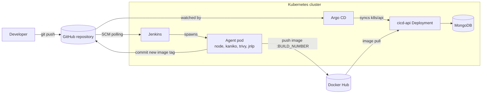

# cicd-lab

A hands-on CI/CD laboratory: a small **Node.js + MongoDB REST API** that is tested, built into a container image and deployed to **Kubernetes** automatically, using **Jenkins** for CI and **Argo CD** for GitOps-style delivery.

Every push to `main` runs the whole chain, from lint and tests to a new pod running the new image, with no manual `kubectl` involved.

## Table of contents

- [How it works](#how-it-works)
- [Tech stack](#tech-stack)
- [Repository structure](#repository-structure)
- [The API](#the-api)
- [Run the API locally](#run-the-api-locally)
- [Tests](#tests)
- [CI/CD pipeline](#cicd-pipeline)
- [Kubernetes setup](#kubernetes-setup)
- [Configuration reference](#configuration-reference)
- [Troubleshooting](#troubleshooting)
- [Known limitations and roadmap](#known-limitations-and-roadmap)

## How it works



1. A push to `main` triggers the Jenkins pipeline (`cicd-api/Jenkinsfile`).
2. Jenkins starts a **disposable agent pod** in the cluster. It runs install, lint, syntax check, tests and a dependency audit.
3. **Kaniko** builds the image inside the cluster (no Docker daemon) and pushes it to Docker Hub as `:<BUILD_NUMBER>` and `:latest`.
4. The last deploy stage **commits the new tag** into `k8s/api/deployment.yaml` on `main`.
5. **Argo CD** sees the Git change, marks the app `OutOfSync`, syncs it and Kubernetes performs a rolling update.

Jenkins never talks to the cluster to deploy. Git is the single source of truth for what runs.

> **Why not just use `:latest`?** If the manifest never changes, Argo CD sees nothing to sync and Kubernetes never recreates the pod. A unique tag per build makes every deploy a visible Git change, and rolling back is a `git revert`.

## Tech stack

| Area        | Technology                                                    |
| ----------- | ------------------------------------------------------------- |
| API         | Node.js 22, Express 5, Mongoose 9, Swagger UI (OpenAPI 3.0.3) |
| Database    | MongoDB 8                                                     |
| Tests       | Node.js built-in test runner (`node:test`)                    |
| CI          | Jenkins (LTS, JDK 21) with Kubernetes dynamic agents          |
| Image build | Kaniko (daemonless, runs as a container in the agent pod)     |
| Registry    | Docker Hub                                                    |
| CD          | Argo CD (GitOps)                                              |
| Runtime     | Kubernetes                                                    |

## Repository structure

```text
.
├── cicd-api/
│   ├── Dockerfile
│   ├── Jenkinsfile              # The CI pipeline
│   ├── compose.yaml             # Local run: API + MongoDB
│   ├── package.json
│   └── src/
│       ├── server.js            # Express app, health endpoints, generic CRUD routes
│       ├── models/models.js     # Mongoose models
│       ├── docs/swagger.js      # OpenAPI specification
│       └── tests/               # node:test suites
└── k8s/
    ├── namespace.yaml           # Namespaces: cicd and argocd
    ├── api/                     # API Deployment and Service (watched by Argo CD)
    ├── mongodb/                 # MongoDB Deployment, PVC and Service
    ├── jenkins/
    │   ├── deployment.yaml      # Jenkins controller
    │   ├── pvc.yaml             # Persistent jenkins_home
    │   └── node-agent.yaml      # Agent pod template (NOT applied with kubectl)
    └── configs/
        ├── rbac.yaml            # ServiceAccount, Role and RoleBinding for Jenkins agents
        └── service.yaml         # Jenkins Service (HTTP 8080 and agent 50000)
```

## The API

A study API that exposes generic CRUD routes for five resources, plus a set of health and diagnostics endpoints.

### Models

| Model      | Fields                                                                                                      |
| ---------- | ----------------------------------------------------------------------------------------------------------- |
| `User`     | `name`, `email` (unique), `password`                                                                        |
| `Category` | `name` (unique)                                                                                             |
| `Post`     | `title`, `content`, `user` (ref), `category` (ref, optional)                                                |
| `Comment`  | `content`, `user` (ref), `post` (ref)                                                                       |
| `PostLike` | `user` (ref), `post` (ref), unique compound index on `user` + `post`. Stored in the `post_likes` collection |

All models have `created_at` and `updated_at` timestamps.

### Resource endpoints

Available for each of `/users`, `/posts`, `/categories`, `/comments` and `/post-likes`:

| Method   | Path                            | Description                     |
| -------- | ------------------------------- | ------------------------------- |
| `POST`   | `/{resource}`                   | Create                          |
| `GET`    | `/{resource}`                   | List all                        |
| `GET`    | `/{resource}/{id}`              | Get by ID                       |
| `PUT`    | `/{resource}/{id}`              | Update                          |
| `DELETE` | `/{resource}/{id}`              | Delete                          |
| `GET`    | `/{resource}/exists-by-id/{id}` | Check whether a resource exists |

Errors follow a consistent shape: `400` for invalid IDs or validation errors, `404` for missing resources, `409` for unique-constraint violations, `500` otherwise.

### Health and diagnostics

| Path                       | Purpose                                                          |
| -------------------------- | ---------------------------------------------------------------- |
| `GET /health`              | Basic availability and API version                               |
| `GET /health/live`         | Liveness: the process is alive, with uptime                      |
| `GET /health/ready`        | Readiness: `200` only when MongoDB is connected, otherwise `503` |
| `GET /health/database`     | MongoDB ping with latency                                        |
| `GET /health/dependencies` | Status of all dependencies (`UP` or `DEGRADED`)                  |
| `GET /health/runtime`      | Node.js version, uptime and process memory                       |
| `GET /health/system`       | Host info, CPU count, load average and memory usage              |
| `GET /health/performance`  | Request count, error count and average response time             |

### Documentation

- Swagger UI: `http://localhost:3000/api-docs`
- Raw spec: `http://localhost:3000/api-docs/swagger.json`

## Run the API locally

### With Docker Compose

```bash
cd cicd-api
docker compose up --build
```

This starts the API on port `3000` and a MongoDB 8 container. The API waits for MongoDB's health check before starting.

### With Node.js

Requires Node.js 22 and a reachable MongoDB.

```bash
cd cicd-api
npm ci
```

Create a `.env` file (it is git-ignored):

```env
PORT=3000
MONGODB_URI=mongodb://localhost:27017/cicd_api
```

Then run:

```bash
npm run dev      # nodemon, auto-reload
# or
npm start
```

Quick check:

```bash
curl localhost:3000/health
```

## Tests

```bash
cd cicd-api
npm test         # runs all *.test.js files with node --test
```

The suites validate the Mongoose schemas in memory with `validateSync()` (required fields, unique indexes, ObjectId casting, timestamps and the `PostLike` compound index) and check the OpenAPI spec. **No database is needed**, which is what lets them run inside the CI pipeline.

`npm run test:ci` also writes a JUnit report to `reports/junit.xml`, which Jenkins publishes.

## CI/CD pipeline

The pipeline is declarative and lives in [`cicd-api/Jenkinsfile`](cicd-api/Jenkinsfile).

### Stages

| Stage                      | What it does                                                                                                                                                        |
| -------------------------- | ------------------------------------------------------------------------------------------------------------------------------------------------------------------- |
| **Info**                   | Prints Node/npm versions and the Git branch                                                                                                                         |
| **Install**                | `npm ci`                                                                                                                                                            |
| **Lint**                   | `npm run lint --if-present` (skipped while no `lint` script exists)                                                                                                 |
| **Syntax check**           | `node --check` on the main source files                                                                                                                             |
| **Test**                   | `npm run test:ci`, then publishes the JUnit report                                                                                                                  |
| **Security audit**         | `npm audit --omit=dev --audit-level=high`. Findings mark the stage `UNSTABLE` without failing the build                                                             |
| **Build and Push Image**   | Kaniko builds `cicd-api/Dockerfile` and pushes `:<BUILD_NUMBER>` and `:latest` to Docker Hub                                                                        |
| **Scan image with Trivy**  | Present in the Jenkinsfile but **currently commented out**                                                                                                          |
| **Update GitOps manifest** | `main` only. Replaces the image tag in `k8s/api/deployment.yaml`, commits and pushes. Runs in the `jnlp` container because the Alpine `node` container has no `git` |
| **CI Summary**             | Prints a build summary (job, commit, image tags, manifest image lines)                                                                                              |

### The agent pod

Each build runs in a fresh pod defined by `k8s/jenkins/node-agent.yaml`, with these containers:

- `node` runs install, lint, tests and audit (default container for steps).
- `kaniko` builds and pushes the image.
- `trivy` is ready for the (currently disabled) vulnerability scan.
- `jnlp` is added automatically by the Jenkins Kubernetes plugin and is used for the Git push.

The pod is destroyed when the build ends, so no workspace cleanup is needed.

### Jenkins requirements

**Plugins:** Pipeline, Git, Kubernetes, Credentials Binding, JUnit and Timestamper.

**Credentials** (Manage Jenkins > Credentials > Global, kind _Username with password_):

| ID                | Username            | Password                                                                     |
| ----------------- | ------------------- | ---------------------------------------------------------------------------- |
| `dockerhub-creds` | Docker Hub username | Docker Hub **access token** with _Read & Write_ permission                   |
| `github-creds`    | GitHub username     | Fine-grained token with **Contents: Read and write** on this repository only |

**Kubernetes cloud** (Manage Jenkins > Clouds > New cloud > Kubernetes):

- Kubernetes URL: leave empty (Jenkins runs inside the cluster)
- Namespace: `cicd`
- Jenkins URL: `http://jenkins.cicd.svc.cluster.local:8080`
- WebSocket: enabled

**Job** (Pipeline, _Pipeline script from SCM_):

- SCM: Git, this repository, branch `*/main`
- Script Path: `cicd-api/Jenkinsfile`
- Build trigger: Poll SCM (for example `H/2 * * * *`)
- Additional Behaviours > **Polling ignores commits in certain paths** > Excluded Regions: `k8s/api/deployment\.yaml`

> The excluded region is essential. Without it, the commit that Jenkins pushes to update the image tag triggers a new build, which pushes another commit, forever.

## Kubernetes setup

The manifests assume a cluster with a default storage class for `ReadWriteOnce` volumes. `k8s/jenkins/pvc.yaml` requests `local-path`, which is the default in k3s and k3d. Change it for other distributions.

### 1. Namespaces, RBAC and the Jenkins Service

```bash
kubectl apply -f k8s/namespace.yaml
kubectl apply -f k8s/configs/
```

### 2. MongoDB

The MongoDB secret is intentionally **not** in Git (`k8s/mongodb/secret.yaml` is git-ignored). Create it yourself:

```bash
kubectl create secret generic mongodb-secret -n cicd \
  --from-literal=MONGO_INITDB_ROOT_USERNAME=<user> \
  --from-literal=MONGO_INITDB_ROOT_PASSWORD=<password>

kubectl apply -f k8s/mongodb/
```

### 3. Jenkins

Apply only the PVC and the Deployment. `node-agent.yaml` is a pod _template_ read by the pipeline, not something to apply.

```bash
kubectl apply -f k8s/jenkins/pvc.yaml -f k8s/jenkins/deployment.yaml
kubectl port-forward -n cicd svc/jenkins 8080:8080
kubectl exec -n cicd deploy/jenkins -- cat /var/jenkins_home/secrets/initialAdminPassword
```

Open `http://localhost:8080` and finish the setup. Then configure the plugins, credentials, cloud and job described in [Jenkins requirements](#jenkins-requirements).

### 4. Argo CD

```bash
kubectl apply -n argocd --server-side --force-conflicts \
  -f https://raw.githubusercontent.com/argoproj/argo-cd/stable/manifests/install.yaml

kubectl port-forward svc/argocd-server -n argocd 8081:443

kubectl -n argocd get secret argocd-initial-admin-secret \
  -o jsonpath="{.data.password}" | base64 -d; echo
```

Open `https://localhost:8081` (self-signed certificate) and log in as `admin`. Port `8081` is used so it does not collide with Jenkins on `8080`.

### 5. Register the application in Argo CD

The Argo CD `Application` is not stored in this repository. Apply it once, replacing `repoURL` with your fork:

```yaml
apiVersion: argoproj.io/v1alpha1
kind: Application
metadata:
  name: cicd-api
  namespace: argocd
spec:
  project: default
  source:
    repoURL: https://github.com/<your-user>/cicd-lab.git
    targetRevision: main
    path: k8s/api # only this folder, never the whole k8s/
  destination:
    server: https://kubernetes.default.svc
    namespace: cicd
  syncPolicy:
    automated:
      prune: true
      selfHeal: true
```

> Do not point the application at the whole `k8s/` folder. Argo CD would start managing, and pruning, Jenkins and MongoDB.

### 6. API secret

The API reads its connection string from a secret that is also kept out of Git:

```bash
kubectl create secret generic cicd-api-secret -n cicd \
  --from-literal=MONGODB_URI='mongodb://<user>:<password>@mongodb.cicd.svc.cluster.local:27017/cicd_api?authSource=admin'
```

### 7. Try it

```bash
kubectl get pods -n cicd -w
kubectl port-forward -n cicd svc/cicd-api 3000:3000
curl localhost:3000/health/ready
```

To see the whole flow, change something in the API and push to `main`. Watch Jenkins build, a `ci: deploy cicd-api image N` commit land on GitHub, Argo CD turn `OutOfSync` then `Synced`, and a new pod replace the old one.

Because Jenkins now commits to `main`, run `git pull --rebase` before your next local push.

## Configuration reference

### Application environment variables

| Variable      | Required | Default | Description                                                       |
| ------------- | -------- | ------- | ----------------------------------------------------------------- |
| `MONGODB_URI` | Yes      | none    | MongoDB connection string. The process exits if it cannot connect |
| `PORT`        | No       | `3000`  | HTTP port                                                         |

### Using your own accounts

If you fork this project, replace `andersoncrms` with your Docker Hub username in:

- `cicd-api/Jenkinsfile` (`IMAGE_REPO` and the `sed` / `grep` patterns in _Update GitOps manifest_)
- `k8s/api/deployment.yaml` (`image:`)

## Troubleshooting

| Symptom                                       | Cause and fix                                                                                      |
| --------------------------------------------- | -------------------------------------------------------------------------------------------------- |
| `Invalid agent type "kubernetes"`             | The Kubernetes plugin is not installed                                                             |
| `No Kubernetes cloud was found`               | Create the cloud in Manage Jenkins > Clouds                                                        |
| Agent pod never starts                        | `kubectl describe pod -n cicd <pod>`. Usually RBAC, the Jenkins URL or resource limits             |
| `git: not found` in a stage                   | The Alpine `node` container has no git. Run Git steps in `container('jnlp')`                       |
| Kaniko `UNAUTHORIZED` on push                 | Docker Hub token is read-only, expired, or has stray whitespace. It needs _Read & Write_           |
| Update stage fails with `403`                 | The GitHub token lacks _Contents: Read and write_, or does not include this repository             |
| Argo CD is `Synced` but the pod never changes | The tag in Git did not change (for example, `:latest`). The pipeline writes a unique tag per build |
| Builds keep triggering themselves             | The excluded region for `k8s/api/deployment\.yaml` is missing in the job's polling configuration   |
| API pod in `CreateContainerConfigError`       | `cicd-api-secret` does not exist in the `cicd` namespace                                           |

## Known limitations and roadmap

This is a learning project, not a production system.

**Limitations**

- The API has **no authentication or authorization**, and user passwords are stored and returned as plain text.
- The Trivy stage is disabled. Even when enabled, it scans the image **after** the push, so a vulnerable image is already published.
- The CI agent uses Node 20 (`k8s/jenkins/node-agent.yaml`) while the production image uses Node 22 (`cicd-api/Dockerfile`). They should match.
- Builds are triggered by polling rather than webhooks.
- Secrets are created by hand instead of being managed declaratively.
- The API is reachable only through `kubectl port-forward` (no Ingress).

**Ideas for next steps**

- Re-enable Trivy and scan the image **before** pushing it (build to a tarball, scan, then push)
- GitHub webhooks instead of polling
- Ingress for the API, Jenkins and Argo CD
- Sealed Secrets or External Secrets
- Separate `dev` and `prod` environments in Argo CD
- Password hashing and authentication in the API
